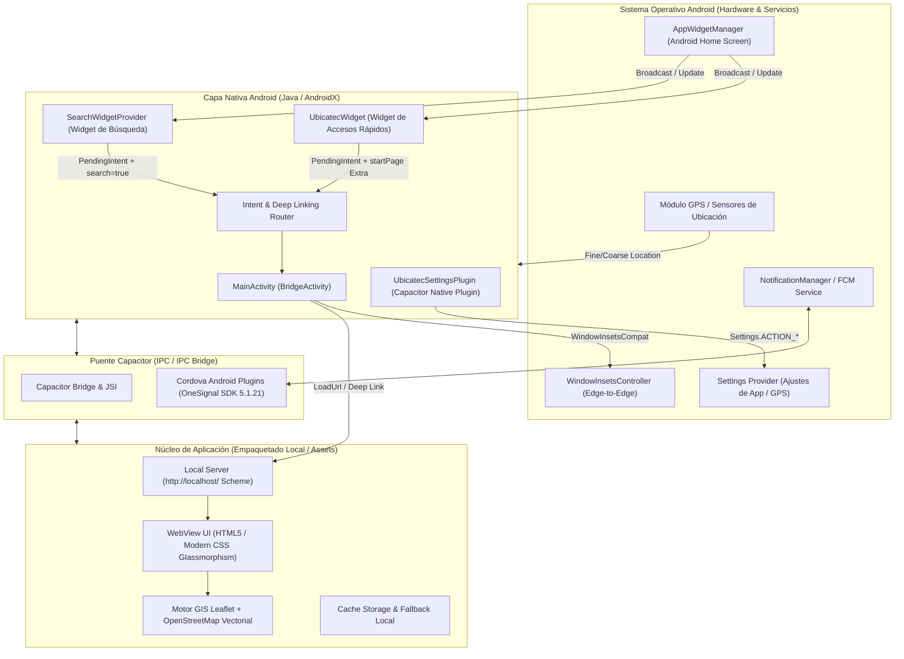

# UBICATEC Android — Aplicación Nativa del Campus del ITP

<p align="center">
  
</p>

<p align="center">
  <strong>Aplicación móvil nativa para Android de orientación espacial, navegación asistida, widgets de escritorio y servicios del Instituto Tecnológico de Puebla.</strong>
</p>

<p align="center">
  
  
  
  
  
</p>

---

> ### 🛡️ Nota de Propiedad Intelectual y Confidencialidad
> **UBICATEC** (en sus versiones Web y Móvil Android) es una obra de software registrada y protegida legalmente ante el **Instituto Nacional del Derecho de Autor (INDAUTOR)** en México.  
> Por motivos de estricta protección a los derechos de autor, patentes de software y acuerdos institucionales, **el código fuente nativo y componentes propietarios se resguardan en un repositorio privado**.
>
> Este repositorio público constituye un **Estudio de Caso de Ingeniería de Software Móvil (*Mobile Case Study*)** y portafolio profesional, cuyo propósito es documentar las decisiones de diseño arquitectónico, integración con el sistema operativo Android, desarrollo de Widgets para la pantalla de inicio y la resolución de desafíos de rendimiento móvil.

---

## 📌 1. Visión del Proyecto Móvil

Tras el desarrollo y despliegue de la versión Web (PWA) de **UBICATEC**, surgió la necesidad de crear una **solución móvil dedicada** que aprovechara las capacidades nativas del sistema operativo Android y brindara una experiencia de usuario más fluida, inmersiva e integrada con el día a día de la comunidad del **Instituto Tecnológico de Puebla (ITP)**.

### ¿Por qué una App Android Nativa?

1. **Acceso Inmediato sin Fricción (Widgets en Pantalla de Inicio):**  
   Los estudiantes necesitan saber cómo llegar a un aula o laboratorio entre clases con rapidez. La app incorpora widgets nativos para la pantalla de inicio que permiten buscar edificios o abrir el mapa con un solo toque desde el escritorio de su smartphone.
2. **Experiencia Visual Inmersiva (Edge-to-Edge):**  
   Eliminación total de barras de navegación de navegadores web y adaptación al diseño de pantalla completa de terminales modernos con soporte de gestos del sistema.
3. **Integración con Ajustes del Sistema Operativo:**  
   Capacidad de gestionar y redirigir al usuario directamente a las pantallas nativas de configuración de permisos de geolocalización (GPS) y notificaciones si se encuentran deshabilitados.
4. **Notificaciones Push a Nivel de Sistema Operativo:**  
   Canal de avisos en segundo plano optimizado con OneSignal y Firebase Cloud Messaging (FCM) con soporte para Android 13+ (`POST_NOTIFICATIONS`).
5. **Autonomía y Resiliencia Total:**  
   Todo el motor cartográfico, base de datos de edificios y assets se encuentran empaquetados localmente en los assets nativos de la aplicación, permitiendo un funcionamiento continuo sin depender de conexiones de red.

---

## 🏛️ 2. Arquitectura del Sistema Móvil

La aplicación está construida sobre una arquitectura híbrida moderna utilizando **Capacitor 8** y **Android SDK 36**, vinculando un núcleo web de alto rendimiento con controladores y servicios nativos en **Java 21**:



---

## ⚡ 3. Componentes Nativos Destacados

### 1. Inmersión Total Edge-to-Edge (`MainActivity.java`)
- Control avanzado de la ventana (`WindowInsetsControllerCompat`) para API 30+ (Android 11 a 16).
- Ocultamiento de la barra de estado y de navegación con comportamiento `BEHAVIOR_SHOW_TRANSIENT_BARS_BY_SWIPE`.
- Barras de sistema transparentes (`Color.TRANSPARENT`) para que el mapa y la interfaz ocupen el 100% del área del panel AMOLED/LCD.
- Rutina de fallback para compatibilidad con versiones anteriores (Android 7 a 10).

### 2. Enrutador de Deep Linking e Intents de Widgets
- La `MainActivity` implementa un despachador en `handleWidgetNavigation(Intent intent)`:
  - Lee el parámetro `startPage` inyectado por los widgets de la pantalla de inicio.
  - Normaliza la ruta solicitada y la despacha al hilo de interfaz de usuario de la WebView interna bajo el esquema `http://localhost/{page}`.
  - Manejo eficiente en arranque en frío (`onCreate`) y reanudación de actividad (`onNewIntent`).

### 3. Widget de Búsqueda de Edificios (`SearchWidgetProvider.java`)
- **Tipo:** Android App Widget (`AppWidgetProvider`).
- **Diseño (`res/layout/search_widget.xml`):** Barra de búsqueda con esquinas redondeadas y tipografía moderna que simula un campo de búsqueda nativo.
- **Acción:** Al ser pulsado por el usuario, emite un `PendingIntent` inmutable que lanza la app directamente en `aula.html?search=true`, desplegando el teclado y el autocompletado en milisegundos.

### 4. Widget de Accesos Rápidos (`UbicatecWidget.java`)
- **Tipo:** Android App Widget de navegación modular.
- **Diseño (`res/layout/ubicatec_widget.xml`):** Panel flotante con 4 accesos rápidos temáticos:
  - 🏛️ **Inicio:** Abre el portal general (`index.html`).
  - 🗺️ **Mapa:** Abre la vista cartográfica interactiva (`aula.html`).
  - 📢 **Redes:** Directorio de canales oficiales (`rs.html`).
  - 👥 **Equipo:** Ficha técnica y créditos institucionales (`equipo.html`).

### 5. Plugin Nativo de Ajustes del Sistema (`UbicatecSettingsPlugin.java`)
- Plugin nativo desarrollado a medida con la anotación `@CapacitorPlugin(name = "UbicatecSettings")`.
- Métodos expuestos al JavaScript del frontend:
  - `openAppSettings()`: Abre la vista de información de la app en Ajustes de Android (`Settings.ACTION_APPLICATION_DETAILS_SETTINGS`) para conceder permisos denegados.
  - `openLocationSettings()`: Lleva al usuario directamente a activar el sensor GPS (`Settings.ACTION_LOCATION_SOURCE_SETTINGS`) cuando la precisión cartográfica lo requiere.

---

## 🛠️ 4. Ficha Técnica Móvil

| Parámetro | Especificación | Descripción |
| :--- | :--- | :--- |
| **Nombre de la Aplicación** | `UBICATEC` | Identificador de la aplicación en el lanzador de Android |
| **Package Name / ID** | `com.ubicatec.app` | Identificador único de paquete en el ecosistema Android |
| **Compile & Target SDK** | `36` (Android 16) | Compilado para las APIs y requisitos de seguridad más recientes de Google |
| **Min SDK** | `24` (Android 7.0 Nougat) | Cobertura superior al 95% del parque de dispositivos Android activos |
| **Gradle / AGP** | Gradle `9.3.1` / AGP `9.1.0` | Cadena de compilación y empaquetado de última generación |
| **Versión de Java** | `Java 21` (LTS) | Estándar de compatibilidad de bytecode de alto rendimiento |
| **Framework Híbrido** | `Capacitor 8` | Puente nativo-web optimizado con esquema seguro `http://localhost/` |
| **Push Notifications** | `OneSignal SDK 5.1.21` + `FCM` | Recepción de notificaciones push prioritarias con soporte para Android 13+ |
| **Permisos Requeridos** | Ubicación fina y gruesa, Notificaciones, Internet | `ACCESS_FINE_LOCATION`, `ACCESS_COARSE_LOCATION`, `POST_NOTIFICATIONS` |

---

## 📂 5. Estructura del Proyecto Android

```
ubicatec-android/
├── app/
│   ├── src/main/
│   │   ├── java/com/ubicatec/app/
│   │   │   ├── MainActivity.java            # Actividad principal, modo inmersivo y enrutamiento
│   │   │   ├── UbicatecSettingsPlugin.java  # Plugin nativo para navegación a Ajustes de Android
│   │   │   ├── UbicatecWidget.java          # Proveedor del Widget de accesos directos
│   │   │   └── SearchWidgetProvider.java    # Proveedor del Widget de búsqueda rápida
│   │   ├── res/
│   │   │   ├── layout/                      # Layouts XML para Widgets de escritorio
│   │   │   ├── xml/                         # Metadatos de AppWidgets y FileProvider
│   │   │   ├── drawable*/                   # Vectores, splash screens y backgrounds
│   │   │   └── mipmap*/                     # Iconos adaptativos de alta densidad
│   │   ├── assets/
│   │   │   ├── capacitor.config.json        # Configuración del contenedor Capacitor
│   │   │   └── public/                      # Assets web empaquetados para ejecución local
│   │   └── AndroidManifest.xml              # Declaración de permisos, receptores y actividades
│   └── build.gradle                         # Dependencias del módulo y configuración de compilación
├── capacitor-cordova-android-plugins/       # Módulo nativo para plugins de OneSignal y Cordova
├── variables.gradle                         # Configuración centralizada de versiones de SDK y AndroidX
└── settings.gradle                          # Estructura de módulos y Gradle convention plugins
```

---

## 🔒 6. Seguridad y Buenas Prácticas

1. **Control Estricto de Permisos en Tiempo de Ejecución (Runtime Permissions):**  
   La aplicación no solicita permisos intrusivos de forma indiscriminada; la ubicación solo se consulta en el momento exacto en que el usuario interactúa con la función "Mi Ubicación" o el cálculo de rutas del campus.
2. **Aislamiento de Almacenamiento y `FileProvider`:**  
   Se utiliza `androidx.core.content.FileProvider` para evitar la exposición de URIs de archivos locales (`file://`), mitigando riesgos de seguridad en transferencias inter-aplicación.
3. **Intents Inmutables para Widgets (`FLAG_IMMUTABLE`):**  
   Todos los `PendingIntent` asociados a los widgets del escritorio están declarados con el flag `PendingIntent.FLAG_IMMUTABLE`, cumpliendo con las directivas de seguridad obligatorias de Android 12 y versiones superiores para evitar manipulaciones de Intents.
4. **Ejecución Local Segura:**  
   La WebView se sirve a través de un servidor local embebido sin requerir conexión a dominios externos para sus funciones principales de navegación y mapa.

---

## 👨‍💻 7. Autoría y Créditos

- **Desarrollador Principal:** Ricardo Armando Polanco Villa ([@Richpol99](https://github.com/Richpol99))
- **Institución:** Instituto Tecnológico de Puebla (ITP)
- **Registro de Obra:** Instituto Nacional del Derecho de Autor (**INDAUTOR**, México)
- **Repositorio de la Solución Web:** [ubicatec-showcase](https://github.com/Richpol99/ubicatec-showcase)
